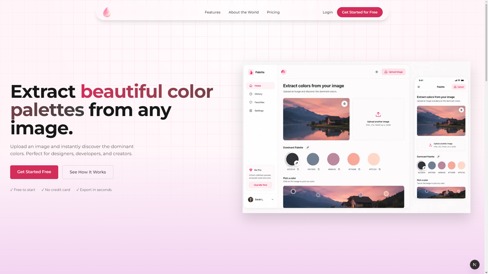
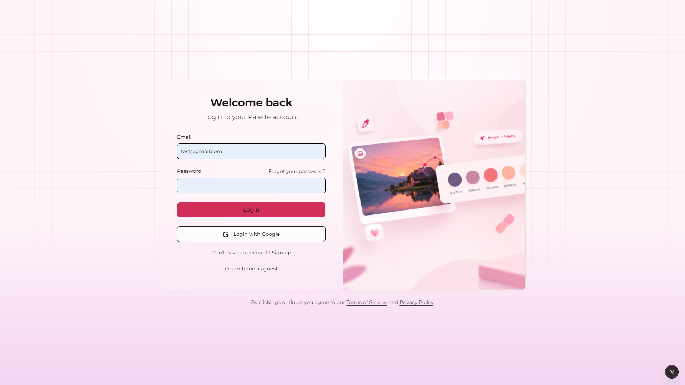
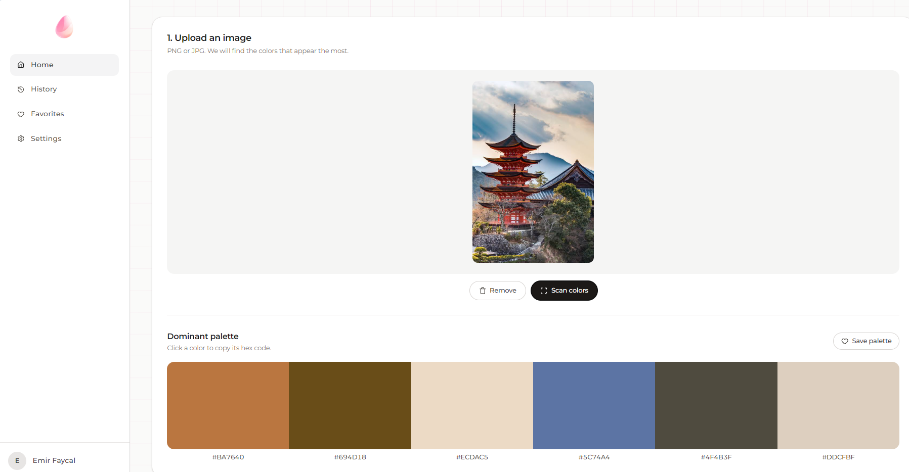
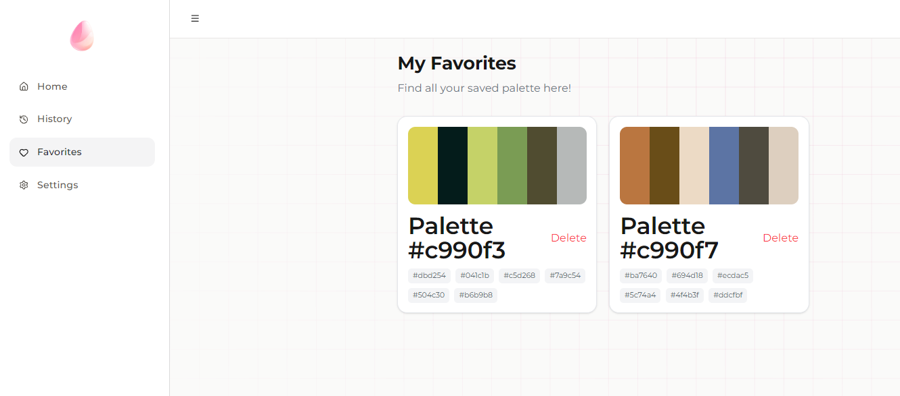
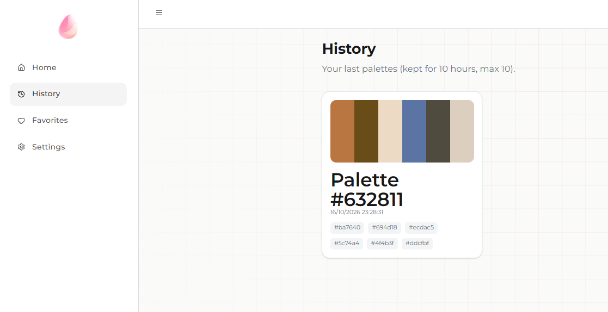

# ColorScan

ColorScan is a fullstack web app that generates a color palette from any picture you upload. You can tweak the result until it fits what you want, save your favorite palettes to your account, and browse your recent history.

Uploaded pictures are never stored. Each image is processed on the fly by the API using `node-vibrant`, and only the resulting colors are kept.



## Features

- Generate a palette from an uploaded image
- Edit the generated colors to get the exact result you want
- Authentication with Google, email and password, or as a guest
- Favorites section to keep the palettes you like (registered users only)
- History of recent palettes, which are also shown randomly in the hero section
- Protected dashboard routes

## Screenshots

### Login



### Dashboard



### Favorites



### History



## Tech Stack

- Next.js 15 (App Router, Server Actions, Route Handlers)
- React 19
- MongoDB with Mongoose
- NextAuth v5 (Google and Credentials providers)
- Tailwind CSS 4 and shadcn/ui
- node-vibrant for color extraction
- bcryptjs for password hashing

## Getting Started

### Prerequisites

- Node.js 18 or later
- A MongoDB database (local or Atlas)
- A Google OAuth client (for Google sign in)

### Installation

```bash
git clone https://github.com/emir-e1/<repository-name>.git
cd <repository-name>
npm install
```

### Environment variables

Create a `.env.local` file at the root of the project:

```env
MONGODB_URL=your_mongodb_connection_string
GOOGLE_CLIENT_ID=your_google_client_id
GOOGLE_CLIENT_SECRET=your_google_client_secret
AUTH_SECRET=a_long_random_string
```

You can generate `AUTH_SECRET` with:

```bash
npx auth secret
```

### Run the app

```bash
npm run dev
```

Then open [http://localhost:3000](http://localhost:3000).

## Project Structure

```
app/
  (landing)/        Public pages (get started, login)
  api/colorscan/    Auth, upload and users endpoints
  dashboard/        Protected area (favorites, history, settings)
components/         UI components
db/                 Mongoose connection and models
lib/                Auth config, server actions, helpers
middleware.js       Dashboard route protection
```

## Authentication

Three ways to use the app:

- **Google**: sign in with a Google account
- **Credentials**: register with an email and a password (hashed with bcrypt)
- **Guest**: enter a name and start right away. The guest session lasts 2 hours and guests cannot save favorites

## Notes

- Palette history entries are automatically removed after 10 hours (MongoDB TTL index)
- Images are processed in memory and are never written to disk or to the database

## Author

E1lusion
GitHub: [emir-e1](https://github.com/emir-e1)
